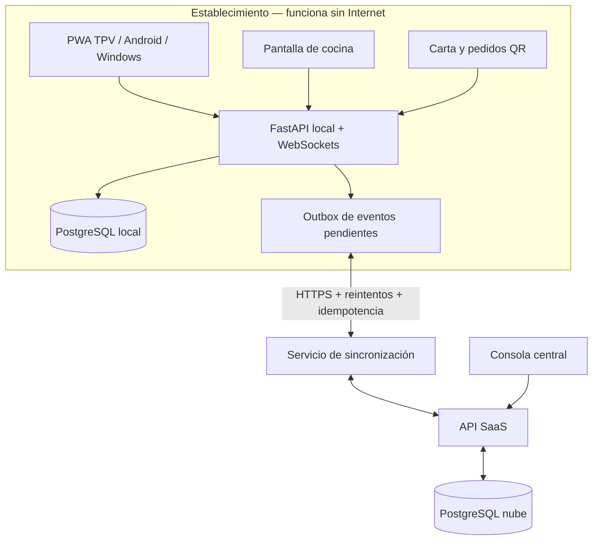

# Arquitectura V2 — TPV Hostelería híbrido

Estado: propuesta técnica inicial aprobada  
Repositorio: kadookesgz/Bar  
Rama: v2-hybrid-architecture

## Objetivo

Evolucionar la aplicación QR inicial de un solo establecimiento hacia un TPV profesional de hostelería, multiempresa y comercializable, con funcionamiento local-first y sincronización con la nube.

## Decisiones

- Multiempresa desde el diseño: cada registro de negocio queda asociado a `tenant_id`; los establecimientos/sucursales se separan mediante `venue_id`.
- Cliente multiplataforma: aplicación web responsive e instalable como PWA en Windows, Android y tablets.
- Operación local: cada establecimiento dispone de un servidor local y base de datos PostgreSQL.
- Nube: consola SaaS para alta de empresas, licencias, configuración central, copias/sincronización y consultas agregadas autorizadas.
- Backend: Python + FastAPI.
- Frontend: Next.js/React como PWA.
- Persistencia: PostgreSQL tanto en nodo local como en nube.
- Tiempo real en LAN: WebSockets.
- Despliegue: Docker Compose en servidor local Linux/Windows con Docker Desktop; clientes acceden por navegador en la red local.
- Identificadores UUID generados por cliente/servidor para permitir sincronización sin depender de secuencias compartidas.

## Diagrama lógico

## Principios de sincronización

1. Las operaciones de venta se confirman primero en la base de datos local.
2. La misma transacción registra un evento en una tabla outbox.
3. El sincronizador envía eventos con UUID, tenant, establecimiento, versión y fecha.
4. La nube procesa eventos idempotentemente y devuelve confirmación.
5. Si no hay conexión, los eventos permanecen pendientes y se reintentan con backoff.
6. No se sincronizan sobrescribiendo indiscriminadamente filas completas.
7. Los datos fiscales, cierres y movimientos de caja son inmutables o rectificables mediante nuevos movimientos auditados; nunca se borran silenciosamente.
8. Los conflictos de catálogo/configuración se resuelven por versión y reglas explícitas; los movimientos de venta se conservan como eventos.

## Modelo de dominio inicial

- Tenant: empresa cliente/armador comercial.
- Venue: local, sucursal o establecimiento.
- User, Role, Permission, UserVenue.
- Product, Category, ModifierGroup, Modifier, TaxRate, PriceList.
- DiningArea, Table, TableSession.
- Order, OrderLine, OrderLineModifier, OrderStatusEvent.
- KitchenStation, KitchenTicket.
- CashRegister, CashShift, CashMovement, Payment, Refund.
- Customer (opcional), Supplier, StockItem, Recipe, StockMovement.
- Device, SyncEvent, AuditLog, Subscription.

Todas las tablas de negocio incluirán `tenant_id`; las que pertenecen a un local incluirán además `venue_id`. La API derivará el ámbito del usuario autenticado y comprobará permisos en servidor. Nunca confiará en un tenant_id enviado libremente por el navegador.

## Seguridad y aislamiento

- Autenticación con sesiones seguras o tokens de corta duración y refresh rotatorio.
- Contraseñas con Argon2id.
- RBAC por empresa y establecimiento.
- HTTPS en accesos remotos; LAN aislada para operación local.
- Rate limiting, protección CSRF cuando proceda, validación estricta y auditoría.
- Separación multiempresa comprobada en servicios y consultas; considerar Row Level Security de PostgreSQL como defensa adicional.
- Códigos QR aleatorios no predecibles; almacenar hash del token y permitir revocación.
- Copias de seguridad cifradas, restauración probada y política de retención.
- Secretos fuera del repositorio; nunca incluir .env real ni bases de datos.

## Impresión y periféricos

La primera versión usará impresión del navegador como fallback. Se diseñará una interfaz de adaptadores para impresoras térmicas ESC/POS, cajón portamonedas, visor y lectores, evitando acoplar el dominio a una marca concreta. La impresión automática se añadirá tras validar modelos reales.

## Fiscalidad española

El módulo de facturación se mantendrá separado del flujo de comandas. Antes de emitir facturas fiscales se implementarán los requisitos aplicables al sistema informático de facturación español, incluyendo integridad, trazabilidad, registros de eventos y modalidad VERI*FACTU cuando corresponda. No se afirmará cumplimiento hasta completar análisis normativo, pruebas y validación profesional.

## Migración desde V1

La V1 existente (FastAPI/SQLite, pedidos QR, caja y cocina) se conservará en main. La V2 se desarrolla en rama separada. Se preparará un importador explícito de categorías, productos, mesas y datos históricos; no se migrará automáticamente la base de datos de producción ni se alterará el formato V1 sin copia y validación.

## Fuera de alcance inicial

- Bizum y pagos online.
- Contabilidad completa.
- Nóminas y gestión laboral.
- Integración fiscal certificada no validada.
- Integraciones cerradas de terceros sin API/documentación.
